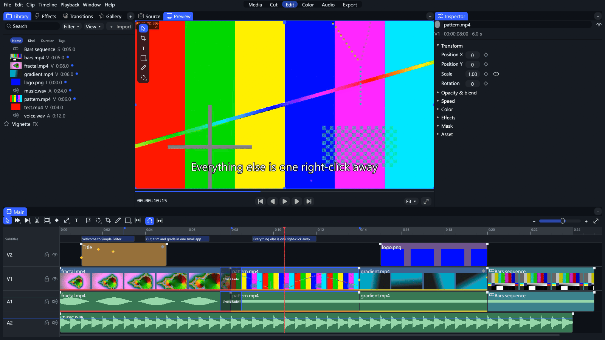

# Simple Editor



**[Documentation & tutorial](https://kashtheking.com/simple-editor/guide/)**: a guide to every part of
the app, with screenshots. New to editing? Start there.

The fastest video editor on Windows. Free. One tiny exe, no install, no subscription, no BS.

Simple Editor is built to take on DaVinci Resolve, Premiere Pro, and CapCut, and win on speed,
simplicity, and community. It's for YouTubers, shorts creators, anime editors, filmmakers, and
anyone editing video for work or school. Everything the big paid apps give you, minus the bloat and
the price tag.

**[Download the latest release](https://github.com/KashTheKing/simple-editor/releases/latest)**
(about 13 MB) and **[join the Discord](https://discord.gg/6taNJVs5FT)**. This is a young project and
I want your feedback. Tell me what's broken, what's missing, what would make you switch for good.

**Found a bug?** Use **Help ▸ Report a Bug…** in the app: it opens a short form on GitHub with your version
filled in. No account? Tell us in the Discord. See [Reporting bugs](#reporting-bugs).

> **Beta software.** Most features are still being tested and polished daily. It's great for
> everyday editing right now, but it's not ready for huge productions or anything mission critical
> yet. Keep backups. It's getting more stable every day.

## Features

On top of all the normal editing stuff (multi-track timeline, trim, cut, split, keyframes, speed
ramping, transitions, blend modes), Simple Editor also has:

- AI transcription, auto subtitles, and double-take detection
- Dead-air removal (auto-cut silence)
- Just one file, ~13 MB, opens almost instantly
- Built-in file converter
- YouTube, TikTok, X, and general URL video downloader/importer
- Luau scripting, plugins, tooling, and expressions
- OpenGL effects plus a custom GLSL shader editor
- Motion tracking, masking, shapes, and live drawing/annotating
- Full audio mixer: EQ, reverb, distortion, compressor, and more
- Node-graph editor for effects
- CapCut-style templates and containers
- Effect and transition presets
- 25+ built-in themes, plus your own custom theme, in cozy or sharp style
- Fully customizable editor layout
- Planning and to-do lists for your project
- Auto-keyframing and velocity tools for smooth animation
- Style-summary generator (auto-writes a style guide for your project)
- **Assistant**: an AI agent (Claude Code, Codex or your own) that edits your project while you watch, writes
  scripts you review and run, and answers your timeline comments. Every request is one undo step
- **HTML + CSS layers**: titles, buttons and scenes written in HTML, with live editing, animatable
  parameters, and **Web Page Snapshot** (copy a real web page in, then fake a mouse over it)
- **Online library**: shader effects and transitions, LUTs, HTML layers, icons and assistant skills,
  downloaded on first use
- Faster, smaller exports: hardware encoders, Speed / Balanced / Smallest file, separate audio tracks
- MCP server (about 300 tools) so any AI agent can help you edit; see [agents.md](agents.md)
- Import/export project files with DaVinci Resolve and Premiere Pro
- And a lot more

## Reporting bugs

The easiest way: **Help ▸ Report a Bug…** in the app. It opens the
[bug form](https://github.com/KashTheKing/simple-editor/issues/new?template=bug_report.yml) with your version
filled in; say what went wrong and how to make it happen again, and drag in a screenshot if you have one. If the
app crashed, attach `crash.log` from `%APPDATA%\SimpleEditor` (it holds a copy of your timeline, so look at it first).
Ideas go to [Suggest a feature](https://github.com/KashTheKing/simple-editor/issues/new?template=feature_request.yml);
questions and chat to the [Discord](https://discord.gg/6taNJVs5FT).

## For AI agents and contributors

Read [agents.md](agents.md) first (workflow, conventions, how to drive the running app over MCP, releasing),
then [goals.md](goals.md), [ARCHITECTURE.md](ARCHITECTURE.md) and [notes.md](notes.md). The MCP tool list
is in [docs/customizing.md](docs/customizing.md); the library file formats are in
[library/README.md](library/README.md). Machine-readable pointers: [llms.txt](website/static/llms.txt).

## Requirements

- Windows 10 or 11 (64-bit). No installer needed.
- [FFmpeg](https://ffmpeg.org) for export, images, and fallback playback. Get it with
  `winget install Gyan.FFmpeg` or `choco install ffmpeg`, or point Settings at its folder. Basic
  playback works without it.

### Optional extras

These stay off until you install their tool. Nothing gets downloaded without you asking.

- **URL import** (YouTube/TikTok/X): install [yt-dlp](https://github.com/yt-dlp/yt-dlp)
  (`winget install yt-dlp.yt-dlp`). File ▸ Import ▸ From URL… works once it's found.
- **AI transcription/subtitles**: put `whisper-cli.exe` from
  [whisper.cpp](https://github.com/ggml-org/whisper.cpp) in `%LOCALAPPDATA%\SimpleEditor\cache\whisper`
  or on your PATH. The app downloads the model for you the first time you use it.
- **Hardware export** (NVENC/QSV/AMF): just needs the matching GPU driver, shows up automatically.

## Build from source

```
cargo build --release
```

Output: `target\release\simple-editor.exe`. Needs Rust 1.88+.

## Run it

Double-click the exe, or `simple-editor.exe video.mp4` to open a file straight away. Right-click any
video in Explorer for an "Edit with Simple Editor" option too.

Every shortcut is rebindable in Settings. Pick a page (Media, Cut, Edit, Color, Audio, Export) for the job at hand,
add panels with a tab bar's `+`, pop any panel into its own window (right-click its tab), and save your
own layouts. See the [tutorial](https://kashtheking.com/simple-editor/guide/) for the rest.

## Test

```
cargo test
```

See `CHANGELOG.md` for what's new and `ARCHITECTURE.md` for how it's built.

## Docs site

The tutorial is a [Docusaurus](https://docusaurus.io) site in `website/`, published to GitHub Pages
whenever `website/` changes on `main`. Preview it with `cd website`, `npm ci`, `npm start`. Its
screenshots come from the real app: re-run `scripts/docs-shots.ps1` after a UI change, and
`simple-editor --dump-hotkeys website/docs/shortcuts.md` after a keymap change.
